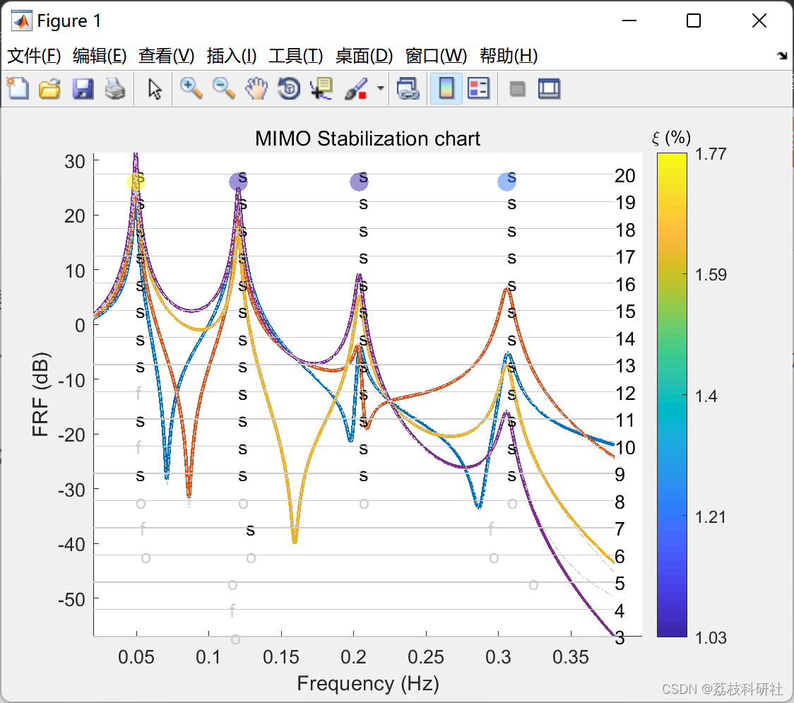

# Research on Rapid Implementation of MIMO Identification Based on LSCF and LSFD Algorithms in Frequency Domain (Matlab Code Implementation)

​  
This algorithm is based on .
- Linear Squared Complex Frequency Estimator (LSCF) uses a discrete time z model to estimate characteristic frequencies and mode damping.
- Minimum-variance Frequency Domain Estimator (LSFD), used to estimate mode residuals.
The selection of identification order and physical poles is assisted by the stability diagrams based on frequency and damping convergence criteria. The stability diagrams can then be automatically interpreted.
📚2 Running Results Editing
🌈3 Matlab code implementation:
clear all  
close all  
clc  
% file test using 4 dofs system with proportional damping  
% for MPIFD_MIMO algorithm  
%  
% modal parameters of the analytical 4 dofs system  
% -- f -- - xi -  
% 0.0494 0.0177  
% 0.1203 0.0104  
% 0.2037 0.0103  
% 0.3059 0.0122  
%  
% load frf in matrix form: one column = one FRF [3001x4]  
load('FRF_tot.mat')  
% load angular frequency in rad/s and in vector form [3001x1]  
load('omg_tot.mat')  
[nbl, nbc] = size(frf) ;  
% selection of the FRF range using frequency betwen 0.02 and 0.38 Hz  
[w1, frf1] = select_frf(w, frf, 0.02, 0.38) ;  
% FRFs plot with frequency range selection, all the next plot will be plotted in  
% figure 1 (stabilization chart, modal FRF, poles).  
figure(1)  
hold on  
frf1log = 20*log10(abs(frf1)) ;  
plot(w1/2/pi, frf1log,'LineWidth', 2)  
% identification using stabilization chart between order 2 and 20  
order = 2:20 ;  
[fn, xin, frfnumtot, FST, FF, XIXI, MATHP] = lscf(w1, frf1, order) ;  
% plot stabilization chart  
plotstabchart(w1, frf1, FST, FF, XIXI, MATHP, order) ;  
% selection of stable poles using stabilization chart, returns poles repeated  
% nbit = 6 times in the tolerance interval tolf = 0.01.  
[fns, xins] = select_stabchart(fn, xin, FST, 0.01, 6) ;  
% calcul of residues and modal frf using selected poles and FRF between  
% force and displacement ('disp') for the modes specified in idx  
idx = 1:4 ;  
[rntot, LRtot, URtot, frfmtot] = lsfd(w1, frf1, fns(idx), xins(idx), 'disp', 1) ;  
% add poles on the stabilization chart using round markers with color  
% proportional to the modal damping factor value.  
add_poles(frf1(:,1), fns, xins)  
🎉4 References

## Images

<!-- PAYMENT_BLOCK -->

## Get this dataset

- Payment link (Stripe): [Buy now](https://buy.stripe.com/3cs8yP7sY87d0vu9AB)
- Payment QR code: 

<!-- /PAYMENT_BLOCK -->
